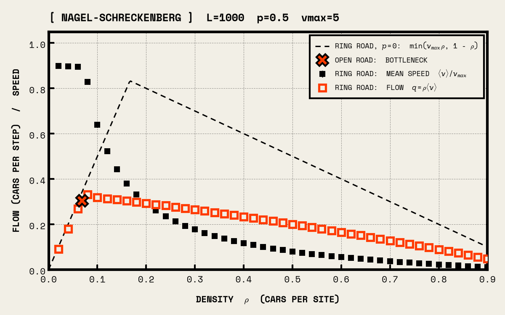
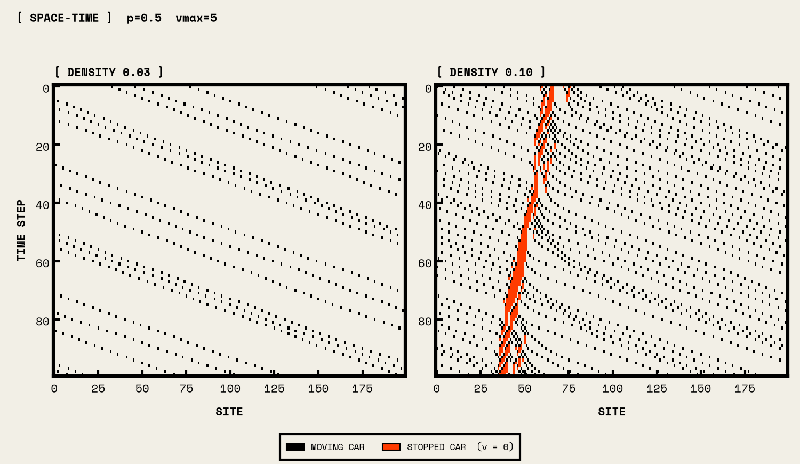
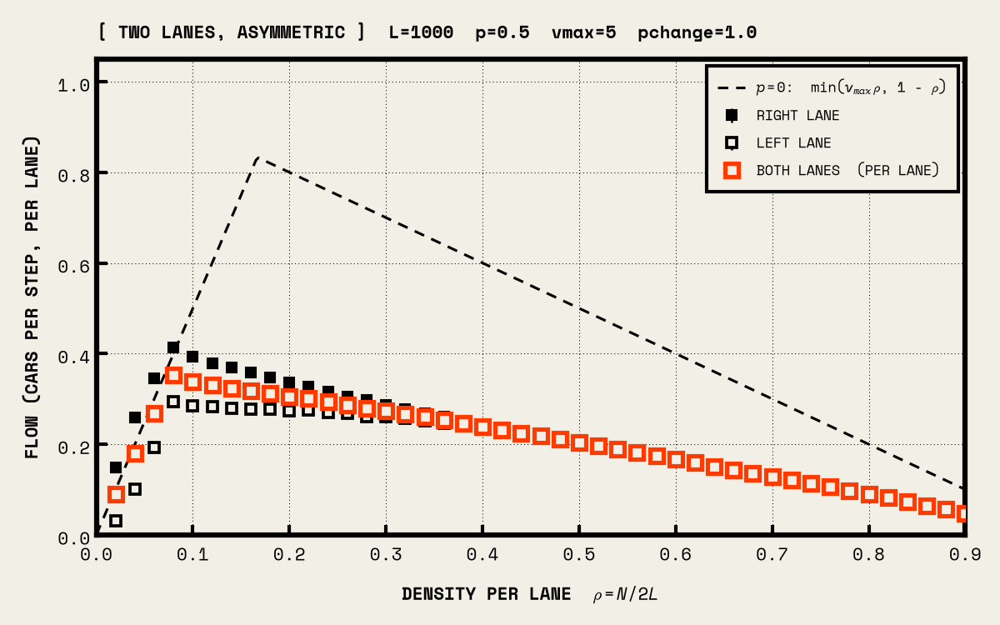
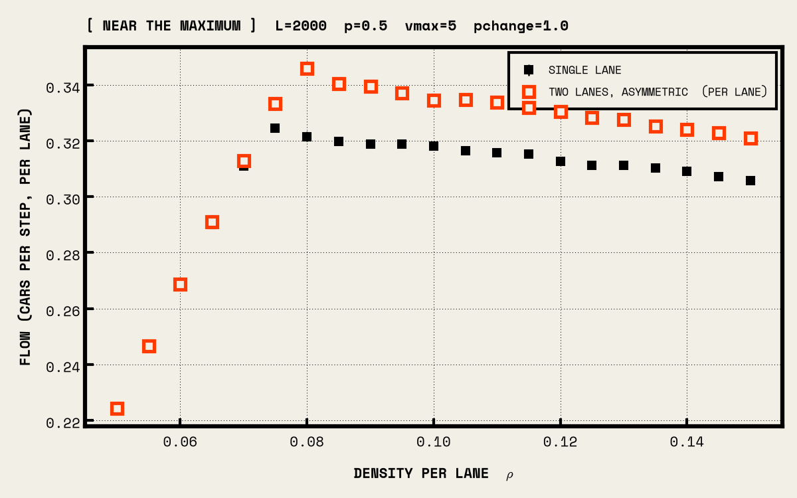
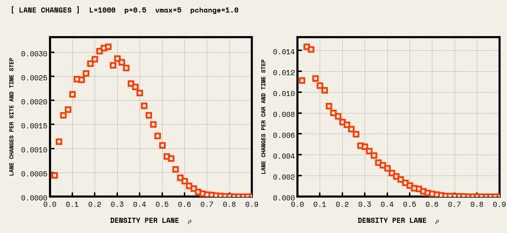
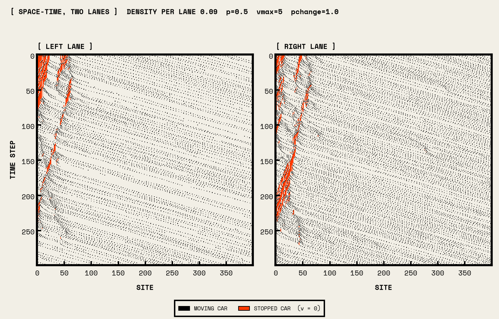

# traffic
Traffic Jam simulator

## Single-Lane Cellular Automata Model. 
Kai Nagel, Michael Schreckenberg. A cellular automaton model for freeway traffic. Journal de Physique I, 1992, 2 (12), pp.2221-2229. ff10.1051/jp1:1992277ff. ffjpa-00246697

The road has `L` sites. Each site is empty or holds one car with an integer speed `0 <= v <= vmax`. At every step, all the cars are updated in parallel:

1. acceleration: if `v < vmax` and the gap `d` to the car ahead is larger than `v + 1`, then `v -> v + 1`
2. slowing down: if `d <= v`, then `v -> d - 1`
3. randomization: with probability `p`, if `v > 0`, then `v -> v - 1`
4. motion: every car advances `v` sites

The paper uses `vmax = 5` and `p = 0.5`.

```python
from model import SingleLane

lane = SingleLane(L=1000, N=100, p=0.5, vmax=5, seed=0)   # a ring with 100 cars
m = lane.measure(T=50000)                                  # relaxes for 10 L steps, then averages
print(m['rho'], m['v'], m['q'], m['dq'])                   # density, mean speed, flow q = rho <v>

bottleneck = SingleLane(L=1000, p=0.5, bc='open')          # cars injected at the left, removed at the right
print(bottleneck.measure(T=300000)['q_out'])               # about 0.304, as in the paper
```

* `bc='periodic'` is a closed ring. `bc='open'` is the bottleneck of Sect. 4 of the paper: a car with `v = 0` is put in the leftmost site when it is empty, and the cars that reach the rightmost `vmax + 1` sites are removed.
* The flow is `q = rho <v>`: the number of cars that cross a bond per step. `measure` gives errors from block averages, since successive steps are correlated.
* `python plots.py` makes the figures below, `python test_model.py` runs the checks (rules against an independent implementation, exact results for `p = 0` and for `vmax = 1`, and the bottleneck of the paper).

## Fundamental diagram
Flow and mean speed against the density of a ring road, `L = 1000`. The cross is the bottleneck, a different experiment: an open road, where the density is not chosen but selected by the boundaries.



## Space-time diagrams
Time goes down. At low density the traffic is laminar, at higher density jams (orange: stopped cars) form and move backwards.



## Two-lane model, asymmetric lane changes
M. Rickert, K. Nagel, M. Schreckenberg, A. Latour. Two lane traffic simulations using cellular automata. Physica A 231 (1996) 534. arXiv:cond-mat/9512119

Two parallel rings of `L` sites. Each time step has two sub-steps: (1) lane change, all the cars decide in parallel and only move sideways, (2) the single-lane update of each lane. A car changes lane if

* `gap < v + 1` (T1: only from the right to the left lane; a car on the left lane always tries to go back to the right),
* `gap_o > v + 1` (T2: room ahead on the other lane),
* `gap_o,back > vmax` (T3: room behind on the other lane),
* `rand < pchange` (T4, the paper uses `pchange = 1`).

```python
from model_multiple import TwoLane

sim = TwoLane(L=1000, N=160, p=0.5, vmax=5, pchange=1.0, seed=0)   # N cars on the two lanes: 0.08 per lane
m = sim.measure(T=50000)
print(m['rho'], m['q'], m['q_right'], m['q_left'], m['c'])         # densities and flows are per lane
```

* `python plots_multiple.py` makes the figures below, `python test_model_multiple.py` runs the checks (the lane-change rule against an independent car-by-car implementation, hand-made situations for every condition, conservation, `pchange = 0` equal to two single lanes).
* The density is the density per lane, `N / (2 L)`, and the flows are per lane.





